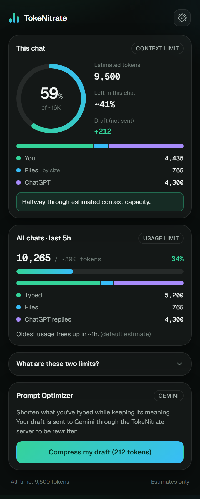
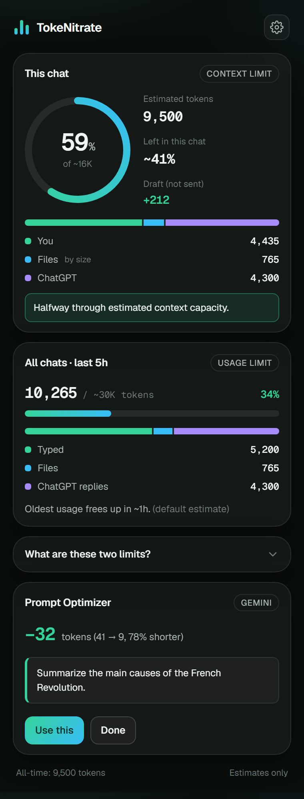
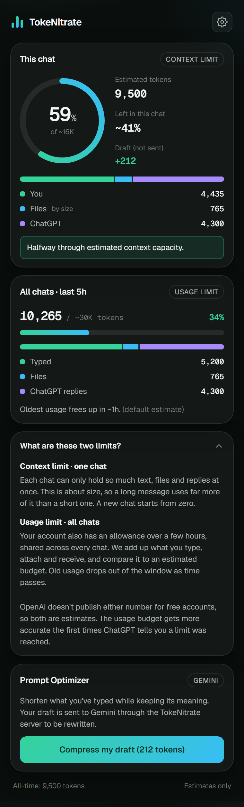
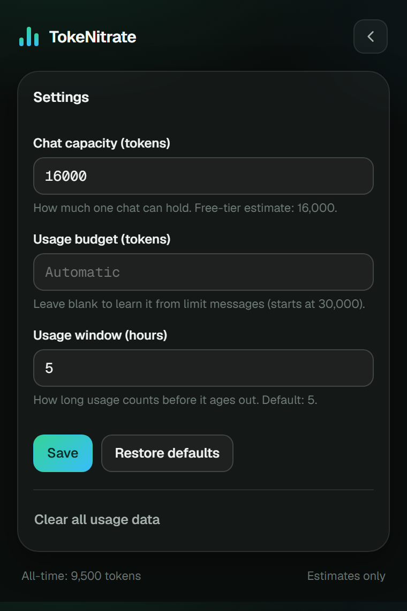
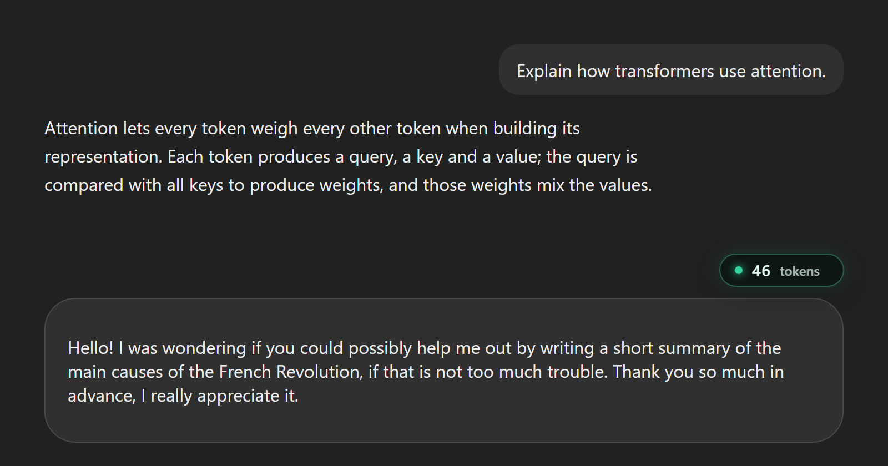
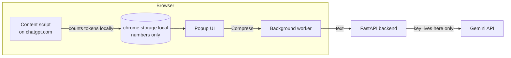

<div align="center">

# TokeNitrate

**See what ChatGPT doesn't show you: how many tokens your chats use.**

A Chrome extension that counts tokens live as you type, tracks two usage limits, estimates attachments, and shortens long prompts with Gemini before you send them.



</div>

> Every figure is an **estimate**, computed in your browser from what ChatGPT shows on the page. It is not OpenAI's official usage or quota. TokeNitrate is an independent project and is not affiliated with OpenAI.

---

## Features

| | |
|---|---|
| **Live draft counter** | An animated badge above the message box shows the token count of what you're typing, updating as you type, with no refresh. |
| **Chat meter (context limit)** | A ring shows how full the current chat is against an estimated 16,000-token free-tier capacity, split into what you typed, files, and ChatGPT's replies. |
| **Usage limit (all chats)** | Adds up tokens across every chat inside a rolling 5-hour window and compares them with an estimated budget. The budget learns from your account when ChatGPT reports a limit. |
| **Attachments** | Files are estimated from their size and type only (contents are never read) and counted once, when the message is sent. |
| **Prompt Optimizer** | Shortens your draft with Gemini (`gemini-3.5-flash-lite`), shows the tokens saved, and lets you insert it or undo. It never sends anything for you. |
| **Settings** | Edit capacity, budget and window, or clear all stored data. |

### Screenshots

<table>
  <tr>
    <td align="center"><br><sub>Prompt Optimizer result</sub></td>
    <td align="center"><br><sub>The two limits, explained in the popup</sub></td>
    <td align="center"><br><sub>Settings</sub></td>
  </tr>
</table>



<sub>The live draft badge above the message box (shown on a local copy of ChatGPT's message-box markup).</sub>

### The two limits

ChatGPT has two different limits, and the popup shows both:

| | Context limit | Usage limit |
|---|---|---|
| Scope | One chat | Your whole account, across all chats |
| Measured in | Tokens in that chat | Tokens used in a rolling window |
| Frees up | Start a new chat | Old usage ages out of the window |

OpenAI publishes neither number for free accounts, so both are estimates and are labelled that way.

---

## Quick start

### 1. Build and load the extension

```bash
cd frontend
npm install
npm run build
```

Open `chrome://extensions`, turn on **Developer mode**, click **Load unpacked** and choose `frontend/dist`. Then **refresh any open ChatGPT tab once**. After that everything updates live.

### 2. Run the backend (only needed for the Prompt Optimizer)

```bash
cd backend
cp .env.example .env      # add your GEMINI_API_KEY to .env (never commit it)
uv sync
uv run uvicorn app.main:app --port 8010
```

### 3. Run the tests

```bash
cd frontend && npm test && npm run lint
cd backend  && uv run pytest
```

A step-by-step walkthrough for presenting it is in [docs/DEMO.md](docs/DEMO.md).

---

## How it works



- The **content script** reads messages and the draft from ChatGPT's page, counts tokens with `o200k_base` (via `js-tiktoken`), and stores only numbers.
- The **popup** reads those numbers and shows the meters. It never sees message text.
- The **backend** holds the Gemini key so it never ships inside the extension, rate-limits each install, and returns the shortened prompt.

More detail: [docs/ARCHITECTURE.md](docs/ARCHITECTURE.md).

## Project layout

```
TokeNitrate/
├─ frontend/                 Chrome extension (React + TypeScript + Vite, Manifest V3)
│  ├─ public/                manifest.json and icons
│  └─ src/
│     ├─ content/chatgpt/    code that runs inside the ChatGPT tab
│     │  ├─ draft/           live draft counter, badge, message-box reader/writer
│     │  └─ attachments/     attachment capture and matching
│     ├─ usage/              stores and pure calculations (ledger, limits, budget)
│     ├─ settings/           user settings and validation
│     ├─ tokenizer/          o200k_base token counting
│     ├─ attachments/        size-based attachment estimator
│     ├─ api/ messaging/     backend client and popup/page message types
│     ├─ popup/ components/  popup UI
│     ├─ styles/             design tokens and component styles
│     └─ config/             every tunable number in one place
├─ backend/                  FastAPI service that calls Gemini
│  ├─ app/                   API code
│  └─ tests/
└─ docs/                     architecture, demo script, known limits, DOM notes, screenshots
```

## Privacy

- Token counting, attachment estimates and limits run entirely in your browser. File contents are never read.
- Only numbers are stored in `chrome.storage.local`, never message text. Draft text is used only to count it.
- Text leaves the browser only when you press **Compress my draft**: it goes to the backend, which sends it to Gemini. The Gemini API key is never inside the extension.

## Accuracy and limits

Token counts use `o200k_base` and can differ from what ChatGPT really spends (hidden system prompts, tools and reasoning are invisible). Attachment estimates are roughly 80-90% accurate. See [docs/KNOWN_LIMITS.md](docs/KNOWN_LIMITS.md).

## Tech

React 19, TypeScript, Vite, Vitest, `js-tiktoken`, Chrome Manifest V3; Python 3.11+, FastAPI, `google-genai`, managed with `uv`.
